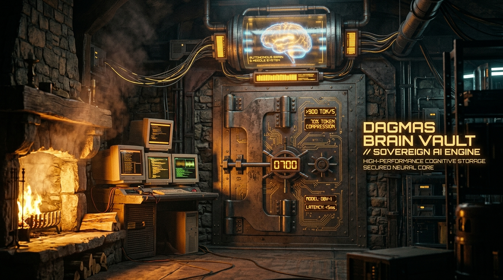
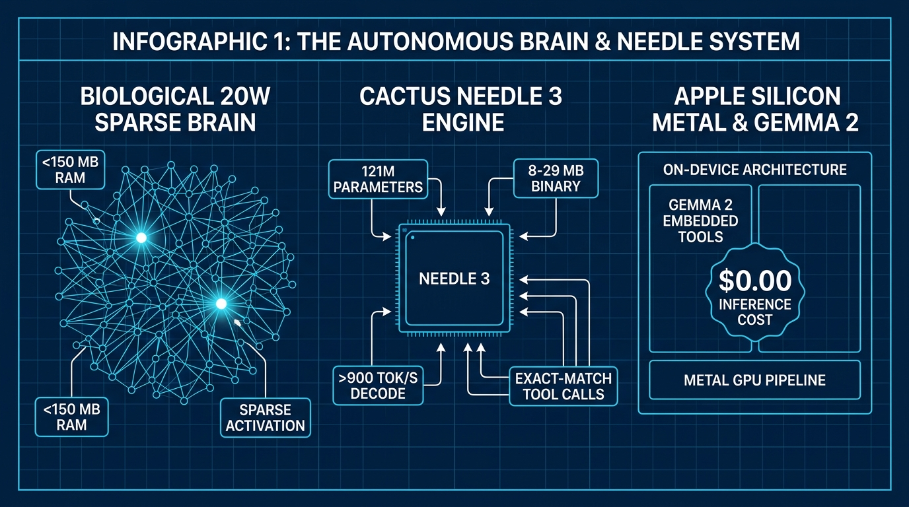
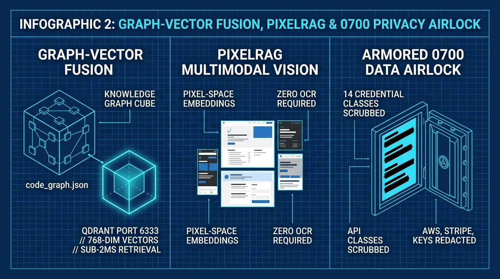
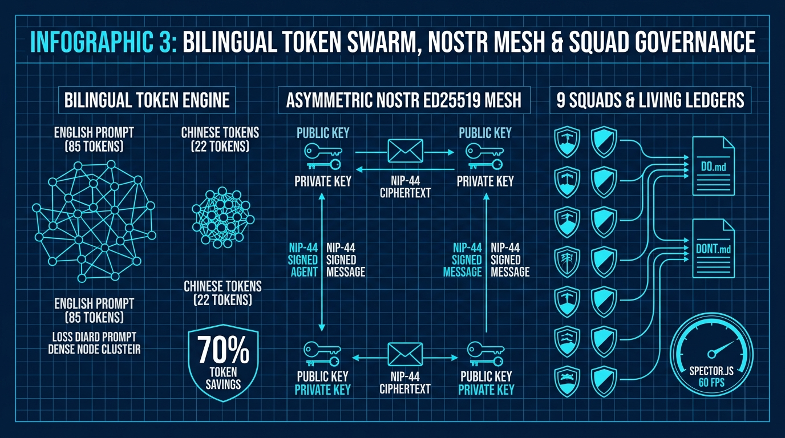
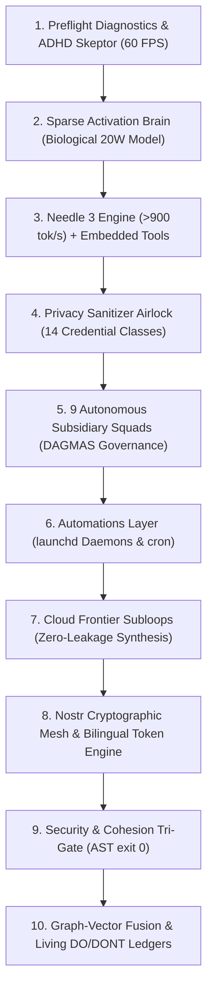

# DAGMAS Brain Vault: Fully Autonomous Brain & Needle System



**The Sovereign Local-First Autonomous Intelligence Architecture That Transforms Token Consumption, Inference Speed, and Multi-Agent Orchestration.**

DAGMAS Brain Vault is a complete, self-governing cognitive operating engine for AI coding agents and swarms. It replaces chaotic cloud dependencies, context window bloat, and uncontrolled token burn with a **local-first Sparse Activation Brain**, ultra-fast **[Needle 3](https://github.com/cactus-compute/needle) tool routing (>900-1,800 tok/s)**, **bilingual token compression (~70% savings)**, **[Graph-Vector Fusion](https://github.com/qdrant/qdrant) memory**, and **0700-armored hardware security**.

Distributed as an **interactive on-demand Skill** (`skills/brain-vault-setup/SKILL.md`) and a standard **[Model Context Protocol (MCP)](https://modelcontextprotocol.io)** tool server (`src/mcp_server.py`).

Zero external dependencies. 100% Python Standard Library. **89 regression tests passing with exit 0.**

[](https://unlicense.org)
[]()
[]()
[](https://github.com/cactus-compute/needle)
[]()
[]()

📖 **Read the Story on X**: [How Did This 8GB RAM MacBook Air Run an Entire AI Brain So Smoothly? (by @xSAMGADx)](https://x.com/xSAMGADx/status/2109392045613695319?s=20)

> [!NOTE]
> **Early Evolutionary Build - Autonomous Self-Learning via Scheduled Cron Jobs:**  
> This release is an **early foundational version** of the DAGMAS architecture. Rather than being static code, the system is designed to **autolearn continuously through background cron jobs**. Every single day, automated cron routines analyze execution logs, identify edge-case mistakes, distill lessons into the living ledgers (`DO.md`, `DONT.md`), and refine graph routing in `code_graph.json`. Every day it runs, DAGMAS gets better, faster, and smarter by learning directly from its mistakes.

---

## About DAGMAS Brain Vault

DAGMAS Brain Vault was engineered from a simple conviction: **our computers should be doing the heavy lifting, not charging us for every token while leaking private credentials across external networks.**

Today's agent ecosystems are bottlenecked by three fatal flaws:
1. **Context & Token Hemorrhage**: Chat histories blow past 100k tokens dragging inactive schemas, causing massive billing runaway and severe KV-cache dilution.
2. **Glacial API Latency**: Routine operations (file inspection, AST linting, test runs, intent routing) stall on round-trip cloud calls (1.5-5 seconds per step).
3. **Total Memory Amnesia & Key Leakage**: Sessions evaporate upon closing, and API keys or private paths travel in plain text inside prompt payloads.

DAGMAS solves this with a **sovereign, local-first triad**:
- **Biological 20W Sparse Brain**: Out of 718+ tracked capabilities, only 2-3 awaken per task (< 150 MB RAM, 0 RPM fan speed, $0.00 compute).
- **Needle 3 Local Tool Router**: Ultra-compact 121M parameter binary (8-29 MB) running on Apple Silicon Metal at **>900 to 1,800 tok/s** with exact-match schema precision.
- **Graph-Vector Fusion + PixelRAG**: Topological knowledge graphs in `code_graph.json` fused with 768-dim [Qdrant](https://github.com/qdrant/qdrant) vectors and pixel-space [PixelRAG](https://github.com/StarTrail-org/PixelRAG) document tiles.
- **Bilingual Compression & Nostr Mesh**: Inter-agent Chinese token compression (~70% savings) wrapped in fiatjaf's [Nostr NIP-44](https://github.com/nostr-protocol/nips/blob/master/44.md) asymmetric cryptographic identity mesh.

---

## The Revised System in 3 Core Infographics

The entire architecture is captured in three comprehensive technical schematics:

### Infographic 1: The Autonomous Brain & Needle System
*Biological 20W Sparse Activation, Cactus Needle 3 On-Device Engine, and Apple Silicon Metal Acceleration.*



- **Biological 20W Sparse Brain**: Only 2 active nodes fire out of 700+ registered tools, preserving RAM (<150 MB) and eliminating KV-cache context dilution.
- **Cactus Needle 3 Micro-Engine**: 121M parameters, 8-29 MB on-device binary, firing precise exact-match function calls at **>900 to 1,800 tokens/sec** with sub-2ms latency.
- **Apple Silicon Metal & Embedded Tools**: Schema-constrained local routing and planning executed at **$0.00 cost** without network egress.

---

### Infographic 2: Graph-Vector Fusion, PixelRAG & 0700 Privacy Airlock
*Hybrid Graph-Vector Memory, Pixel-Space Document Retrieval, and Kernel-Level Credential Redaction.*



- **Graph-Vector Fusion Memory**: 3D isometric knowledge graph (`code_graph.json`) fused with **[Qdrant](https://github.com/qdrant/qdrant)** (port 6333) 768-dimensional dense vectors and **[sqlite-vec](https://github.com/asg017/sqlite-vec)** for sub-2ms hybrid retrieval.
- **PixelRAG Multimodal Vision**: Visual screenshot tiles embedded directly in pixel space without OCR, preserving tables, charts, and architectural layouts ([StarTrail-org/PixelRAG](https://github.com/StarTrail-org/PixelRAG)  |  [arXiv:2606.28344](https://arxiv.org/abs/2606.28344)).
- **Armored 0700 Data Airlock**: Kernel-enforced POSIX `0700` sandbox. 14 live credential classes (AWS, Stripe, Slack, DB DSNs, private keys, ETH wallets) permanently redacted with thick black marker bars before egress.

---

### Infographic 3: Bilingual Token Swarm, Nostr Mesh & Squad Governance
*~70% Token Compression, Asymmetric Ed25519 Cryptographic Bus, and Self-Improving Living Ledgers.*



- **Bilingual Token Engine**: English prompts (85 tokens) compress to dense Simplified Chinese ideographs (22 tokens) for inter-agent traffic - slashing token consumption and KV-cache pressure by **~70%**. English is synthesized for the human creator.
- **Asymmetric Nostr Ed25519 Mesh**: Every agent node generates an Ed25519 keypair; messages travel as [NIP-44](https://github.com/nostr-protocol/nips/blob/master/44.md) encrypted, signed envelopes with zero plaintext snooping on system sockets.
- **9 Autonomous Squads & Living Ledgers**: 9 meritocratic squads (Research, Code, 3D, Legal, Marketing, Design, Data, Community, Ops) update nightly `DO.md` and `DONT.md` handbooks. Incorporates [Spector.js](https://spector.babylonjs.com) frame profiling locked at 60 FPS (<= 16.6 ms).

---

## The 10 Cognitive Pipeline Stages



1. **Preflight Diagnostics & ADHD Skeptor**: Validates environment health, [Qdrant](https://github.com/qdrant/qdrant) on `localhost:6333`, embedder cache, single-task hyperfocus invariant, and [Spector.js](https://spector.babylonjs.com) 60 FPS GPU telemetry.
2. **Sparse Activation Brain**: Biological 20W routing; out of 718 tracked nodes, only activates the 2-3 required for the current milestone.
3. **[Needle 3 Engine](https://github.com/cactus-compute/needle) + Sub-1B Reasoning**: Cactus Compute Needle 3 (121M params, 8-29 MB binary, >900 tok/s function calling) and local sub-1B models for zero-cost edge reasoning via [llama.cpp](https://github.com/ggerganov/llama.cpp) (< 500 MB RAM).
4. **Privacy Sanitizer Airlock**: Real-time inspection and scrubbing of 14 credential classes + custom proprietary regexes before any external transmission.
5. **9 Autonomous Subsidiary Squads**: Research, Engineering, Gaming & 3D, Legal, Sound, Marketing, Crypto, Automations, Publishing operating under meritocratic KPI governance.
6. **Automations & Autolearning Layer**: Background `launchd` daemons and recurring cron jobs that ingest daily execution traces, audit mistakes, and run self-improvement cycles.
7. **Cloud Frontier Subloops**: Dispatches heavy multi-repo synthesis or frontier reasoning to Frontier Cloud Models (Claude/OpenAI) through a scrubbed, sanitized serial airlock.
8. **Nostr Cryptographic Mesh & Bilingual Compression**: Ed25519 signed envelopes over local IPC via [NIP-44](https://github.com/nostr-protocol/nips/blob/master/44.md), paired with Simplified Chinese inter-agent token compression (~70% savings).
9. **Security & Cohesion Tri-Gate**: AST syntax analysis, command injection blocker, and code cohesion gate requiring deterministic `exit 0` (`prove-it-done`).
10. **Graph-Vector Fusion & Living DO/DONT Ledgers**: Automated node/edge indexing in `code_graph.json`, [Qdrant 6333](https://github.com/qdrant/qdrant) / [PixelRAG](https://github.com/StarTrail-org/PixelRAG) storage, and nightly self-healing memory updates where mistakes are etched into `DONT.md` and optimal patterns into `DO.md` so the system gets smarter every single day.

---

## Upstream Sources & Open-Source Lineage

DAGMAS Brain Vault stands on the shoulders of the following pioneering open-source projects, research papers, and standards:

| Component / Layer | Project / Research | Repository / Reference | Key Architectural Role |
| :--- | :--- | :--- | :--- |
| **Cognitive Tool Routing** | **Needle 3 (Cactus Compute)** | [cactus-compute/needle](https://github.com/cactus-compute/needle)  |  [cactuscompute.com](https://cactuscompute.com) | 121M parameter on-device model (8-29 MB binary) delivering >900 to 1,800 tok/s function calling with exact-match schema precision. |
| **Multimodal Vision RAG** | **PixelRAG** | [StarTrail-org/PixelRAG](https://github.com/StarTrail-org/PixelRAG)  |  [arXiv:2606.28344](https://arxiv.org/abs/2606.28344)  |  [pixelrag.ai](https://pixelrag.ai) | Pixel-space visual document & frame retrieval bypassing fragile text OCR pipelines to preserve complex layouts and tables. |
| **Vector Database Engine** | **Qdrant** | [qdrant/qdrant](https://github.com/qdrant/qdrant)  |  [qdrant.tech](https://qdrant.tech) | High-performance vector search engine running on port 6333 across 16 specialized dense memory collections. |
| **Embedded Vector DB** | **sqlite-vec** | [asg017/sqlite-vec](https://github.com/asg017/sqlite-vec) | Pure C/SQLite vector search extension for zero-dependency local vector storage. |
| **GPU Profiling & Telemetry** | **Spector.js (Babylon.js)** | [BabylonJS/Spector.js](https://github.com/BabylonJS/Spector.js)  |  [spector.babylonjs.com](https://spector.babylonjs.com) | Real-time WebGL/WebGPU graphics inspection enforcing <= 16.6 ms frame budgets and 0 shader thrashing. |
| **3D Graphics Engine** | **Babylon.js** | [BabylonJS/Babylon.js](https://github.com/BabylonJS/Babylon.js)  |  [babylonjs.com](https://www.babylonjs.com) | WebGPU-first 60 FPS interactive visual canvas, digital twin simulations, and Havok physics integration. |
| **Local Model Runner** | **llama.cpp** | [ggerganov/llama.cpp](https://github.com/ggerganov/llama.cpp) | Hardware-accelerated Apple Silicon Metal GGUF inference for sub-1B models (< 500 MB RAM, $0.00 cost). |
| **Embedded Tool LLM** | **Llama 3.2 & Gemma 2** | [meta-llama/Llama-3.2-1B-Instruct](https://huggingface.co/meta-llama/Llama-3.2-1B-Instruct)  |  [llama.com](https://www.llama.com) | On-device structured schema calling, tool dispatching, and deterministic planning. |
| **Sub-1B Nano Models** | **Qwen 2.5 & SmolLM2** | [QwenLM/Qwen2.5](https://github.com/QwenLM/Qwen2.5)  |  [SmolLM2-360M](https://huggingface.co/HuggingFaceTB/SmolLM2-360M) | Ultra-lightweight intent classification and preflight planning running on local CPU/Metal. |
| **Decentralized Messaging** | **Nostr Protocol** | [nostr-protocol/nostr](https://github.com/nostr-protocol/nostr)  |  [NIP-44](https://github.com/nostr-protocol/nips/blob/master/44.md)  |  [fiatjaf](https://fiatjaf.com) | Cryptographic asymmetric key derivation, encrypted payloads, and versioned NIP-44 messaging. |
| **Agent Tool Protocol** | **Model Context Protocol (MCP)** | [modelcontextprotocol.io](https://modelcontextprotocol.io)  |  [modelcontextprotocol](https://github.com/modelcontextprotocol) | Open JSON-RPC / stdio standard connecting the vault to Claude Desktop, Cursor, and MCP clients. |
| **Credential Manager** | **Bitwarden CLI** | [bitwarden/clients](https://github.com/bitwarden/clients)  |  [bitwarden.com/help/cli](https://bitwarden.com/help/cli/) | Air-gapped secret resolution via local `bw` CLI vault. |
| **High-Performance Runtime** | **Bun** | [oven-sh/bun](https://github.com/oven-sh/bun)  |  [bun.sh](https://bun.sh) | Blazing-fast JavaScript/TypeScript toolchain, bundler, and test runner. |

---

## The Sovereign Master Skill

Forget rigid installer scripts and blind terminal wizards. DAGMAS operates as a specialized **Master Skill** (`skills/brain-vault-setup/SKILL.md`) used **strictly at system initialization or when performing a system upgrade to this system** (it does not run continuously on every turn).

When invoked, the Master Skill asks you a few questions on what to install. You can execute the commands manually in your terminal, or if your agent has computer use / tool execution capabilities, the agent runs them automatically. Once all tools are confirmed to run and the full preflight diagnostic is smooth (`exit 0`), the agent executes a live test, and finally asks you if you want to set Brain Vault as your permanent default memory and universal backup system:

1. **Interactive Architectural Grill**: Interviews you step-by-step through a structured set of questions:
   - **Core Runtime Engine**: Python (universal zero-setup standard library, dynamic hot-patching) vs. Rust (compiled static binary, sub-millisecond execution, <10 MB RAM).
   - **Bun Web & Tooling Runtime**: Bun runtime (`bun.sh`) for ultra-fast package management (`bun install`, `bun add`), instant TypeScript execution, and Web/Babylon.js 3D tools vs. Python standard library only.
   - **Vector Database**: Qdrant on port 6333, sqlite-vec embedded, or plain markdown ledgers.
   - **Knowledge Graph & Topology (Graphify)**: Automated node/edge dependency mapping in code_graph.json fused with vector retrieval vs. flat file storage.
   - **Local Reasoning Core**: Cactus Compute Needle 3 (>900 tok/s), Gemma 2 Embedded tool schemas, llama.cpp, or Ollama.
   - **Privacy Sanitizer**: Tailors the 14-class credential airlock and custom regex redaction.
   - **Specialist Skills**: Lean core cognitive pipeline vs. custom domain extensions.
   - **Performance Guardrails**: ADHD single-task hyper-focus lock and Spector.js 60 FPS GPU profiling.
   - **Encrypted Mesh & Tokens**: Nostr NIP-44 asymmetric keypairs and Simplified Chinese token compression (~70% savings).
   - **Digital Squad Hierarchy**: Selecting active business subsidiaries and tailoring `SOUL.md` authority boundaries.
   - **Keystore Backend**: Bitwarden CLI (`bw`) or local POSIX `0600` encrypted keystore.
2. **External Tools & Prerequisites First (Dependency Gate)**: You choose automated or manual execution. Before touching the Brain, all required external tools selected (e.g. Qdrant on port 6333, Bun toolchain, llama.cpp runner, Bitwarden CLI) MUST be installed and verified operational with HTTP 200 health checks.
3. **Sovereign Brain Initialization**: Only once external tools are running, initializes the POSIX `0700` sandbox (`~/.brain-vault`), subdirectories (`teams/`, `skills/`, `memory/`, `ledgers/`), canonical schemas (`vault_config.json`, `limits.json`, `registry.json`, `code_graph.json`), and living ledgers (`DO.md`, `DONT.md`, `LESSONS.md`).
4. **Orchestrator Profile & Squad Linking**: Provisions squad `SOUL.md` authority boundaries and registers specialist skills.
5. **Preflight Self-Healing Verification**: Executes the 8-check diagnostic loop (`python3 -m src.preflight`), automatically repairing permissions or missing schemas until 100% green with `exit 0` (`prove-it-done`).
6. **Live Test & Final Confirmation**: Executes an end-to-end functional test (secret encryption and memory graph indexing). Once verified smooth, asks the user: *"Do you want to set Brain Vault as your default memory and universal backup system from now on?"* If approved, installs `dagmas_brain_vault.md` into global agent rules.

---

## Download the Master Skill & Activate

### Step 1: Download the Master Skill File First
Before prompting your assistant, download the Master Skill (`SKILL.md`) into your agent's skills directory:

**Quick 1-Liner (curl):**
```bash
mkdir -p ~/.agents/skills/brain-vault-setup
curl -sSL https://raw.githubusercontent.com/xxSAMGADx/DagmasCore/main/skills/brain-vault-setup/SKILL.md -o ~/.agents/skills/brain-vault-setup/SKILL.md
```

**Or Clone the Full Repository:**
```bash
git clone https://github.com/xxSAMGADx/DagmasCore.git
mkdir -p ~/.agents/skills/brain-vault-setup
cp DagmasCore/skills/brain-vault-setup/SKILL.md ~/.agents/skills/brain-vault-setup/
```

*(For Claude Desktop, Cursor, or other agents, save `SKILL.md` into your agent's configured skills/rules folder or paste it into your context).*

---

### Step 2: Trigger in Your AI Assistant
Open your AI assistant prompt and say:

> *"Set up Brain Vault and grill me on my architecture choices."*

The Master Skill awakens and walks you through a structured set of questions. At the end of answering, you will have your own safe, armored, and custom sovereign brain running right on your machine.

---

## Autonomous Verification & Preflight
```bash
# Run the 8-check diagnostic and self-healing engine
python3 -m src.preflight

# Verify the full 89 regression unit test assertions
python3 -m unittest discover tests -v
```

---

## MCP Server Integration (Claude Desktop, Cursor)
Add DAGMAS to your client's MCP configuration:
```json
{
  "mcpServers": {
    "brain-vault": {
      "command": "python3",
      "args": ["-m", "src.mcp_server"],
      "cwd": "/path/to/DagmasCore"
    }
  }
}
```

---

## A Note From the Creator

> *"I imagined the system. There is way more to it: as you customize your skills, your abilities and system intelligence will grow with you. I hope some of you guys find ways to optimize it even more or create your own evolution. Let's have fun!"* - **samgad**

- **Original Story on X**: [https://x.com/xSAMGADx/status/2109392045613695319?s=20](https://x.com/xSAMGADx/status/2109392045613695319?s=20)
- **Local Markdown Copy**: [`docs/SUBSTACK_ARTICLE_DAGMAS_SYSTEM.md`](docs/SUBSTACK_ARTICLE_DAGMAS_SYSTEM.md)

---

## Open Domain & License

Dedicated to the **Public Domain** under [The Unlicense](https://unlicense.org). Zero copyright restrictions, total sovereignty, pure standard library. Anyone is free to copy, modify, publish, use, compile, sell, or distribute this work for any purpose.
