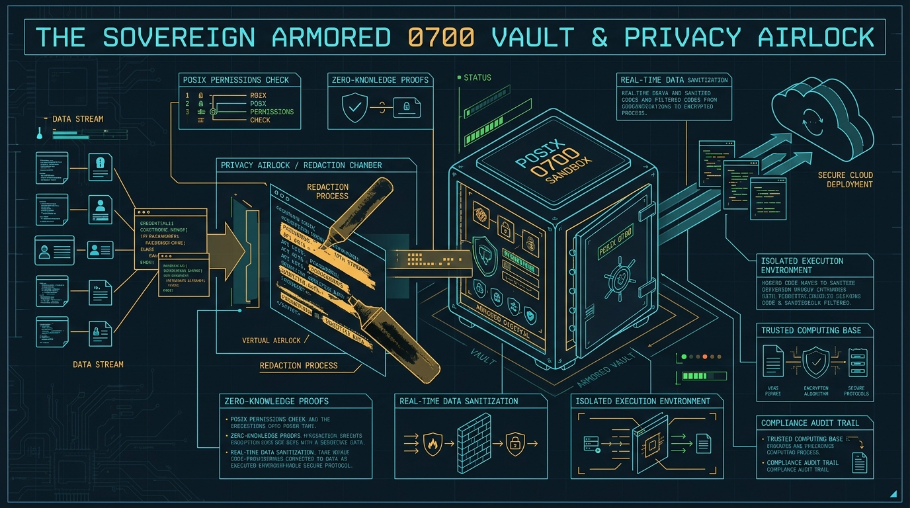
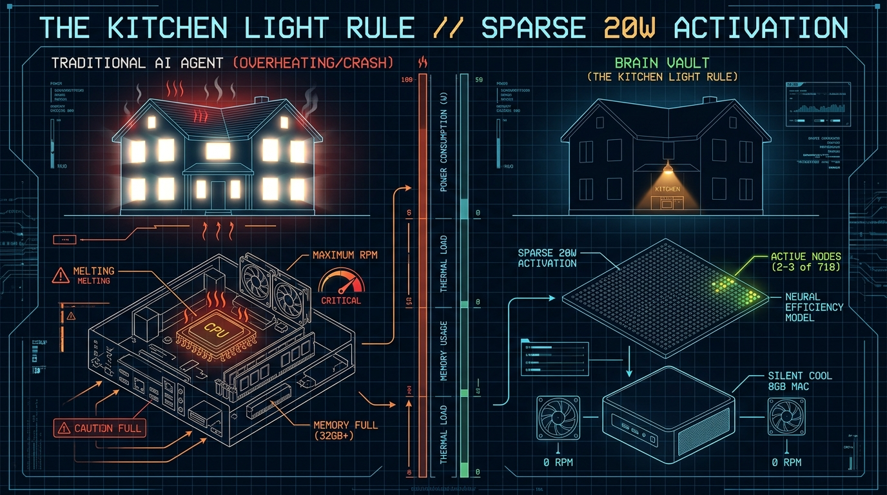
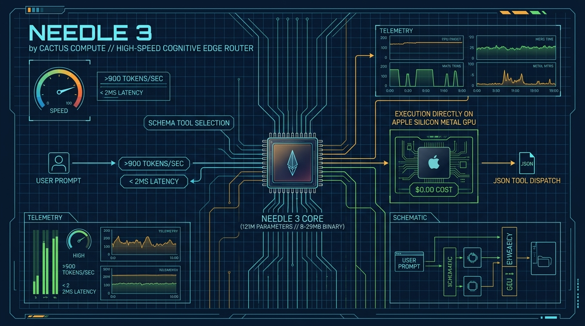
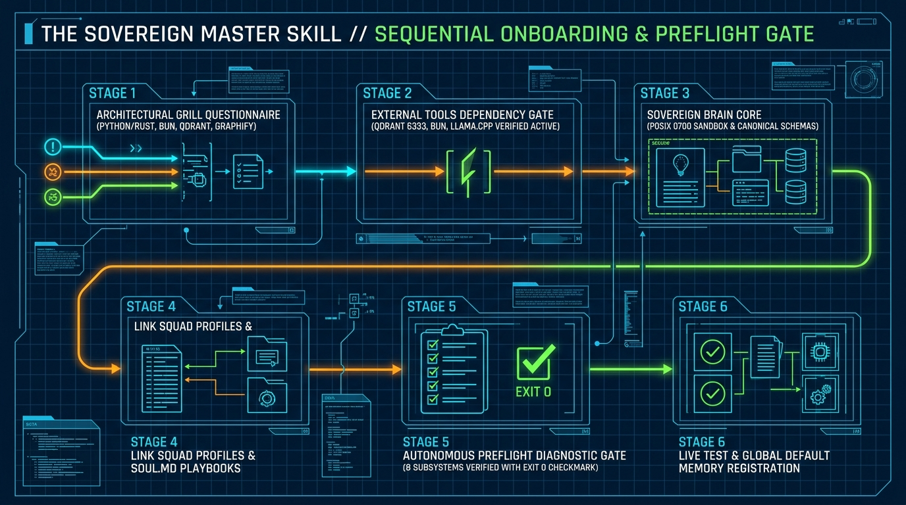
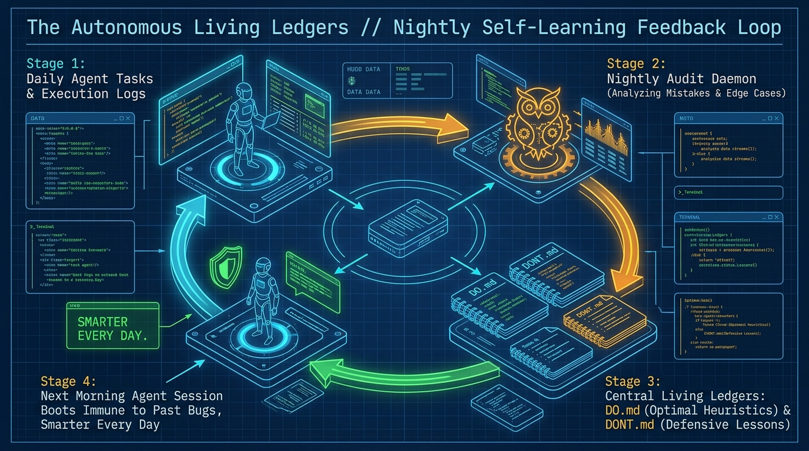

# How Did This 8GB RAM MacBook Air Run an Entire AI Brain So Smoothly?


*Figure 0: DAGMAS Brain Vault // Sovereign AI Engine - An armored local brain running on a base 8GB Mac.*

Pull up a chair. Grab a warm drink.

If you have tried building anything with AI lately, you know the pain:
Ten hours glued to your screen. Eyes burning. Half your day wasted on broken libraries, a cloud bill that quietly creeps up every month, and copy-pasting text back and forth into chat windows while your laptop fans roar like a jet engine on the runway.

One night I leaned back, rubbed my forehead, and asked a simple question:

*Why am I doing chores my computer should be doing for me?*

For about a year now, I have been tinkering on this kind of brain system on and off. I did not want to babysit twenty cloud dashboards. I did not want a rack of loud, expensive servers in my bedroom. I just wanted to "vibecode" - set up a quiet system on my own machine that handles the grind, while I sit back and steer.

So right here on a base 8GB RAM MacBook Air, I imagined the system: **DAGMAS Brain Vault**.

And people always ask me: *How on earth does an 8GB laptop run all of this without crashing or burning a hole in your desk?*

Here is the secret. It is surprisingly simple.

---

### What Is This Thing, Really?

Let us get two big questions out of the way first:
- *Did you spend millions training a huge model?* No.
- *Does it secretly send your data home to a server?* Never.

Brain Vault is not a massive foundation model. It does not try to replace Claude or ChatGPT. 

Instead, think of it as a personal armored vault that sits right on your computer.

Look at how most people work with AI today. Your passwords, API keys, private notes, and half-finished ideas are scattered across random browser tabs, terminal history, and chat logs. Every time you copy-paste into an online AI, you are basically walking down a crowded street with your bank passwords written in big letters across your shirt.

Brain Vault puts all of your files behind one strict digital lock on your own hard drive (what programmers call POSIX `0700` permissions - only your logged-in user can peek inside).

Then it follows two rules:
1. **Handle the daily grind locally for free.** Reading files, organizing folders, running tests, tidying code - about 90% of your daily work - happens right on your Mac at $0.00 cost. Zero cloud fees, zero internet needed.
2. **Scrub before sending.** When you genuinely need a giant cloud model for a massive task, the prompt goes through a security airlock first. It strips out the clutter, blacks out your passwords, blocks trick prompts, and only lets clean text leave your laptop.


*Figure 1: The Sovereign Armored 0700 Vault & Privacy Airlock - POSIX 0700 local file encryption, virtual black marker redaction chamber, and sanitized cloud transmission.*

---

### How an 8GB Mac Stays Cool: The Kitchen Light Rule

Most AI agent setups try to load dozens of heavy tools and gigabytes of data into memory all at once. An 8GB laptop chokes immediately.

We solved that with what I call **The Kitchen Light Rule**:

If you wake up at 3 AM to get a glass of water, you do not turn on every single light in the attic, the garage, the basement, and the guest room. You turn on the kitchen light, drink your water, and go back to bed.

Brain Vault does the exact same thing:
Out of more than 700 capabilities it knows how to do, it only wakes up the 2 or 3 tiny tools needed for the job right in front of it. The rest stay completely asleep. 

Your fans stay at 0 RPM, your battery lasts all day, and your computer stays fast.


*Figure 2: The Kitchen Light Rule // Sparse 20W Activation - Comparing traditional agent memory exhaustion against biological 20W sparse activation (2-3 active nodes, 0 RPM silent 8GB Mac).*

---

### Fast On-Device Thinking: The Needle 3 Engine

Instead of asking a giant, slow cloud model to pick every tiny tool, we use **[Needle 3 by Cactus Compute](https://github.com/cactus-compute/needle)**. It is a tiny 121-million-parameter engine (a tiny 8 to 29 MB file!) that runs directly on your Mac chip. 
- It fires off tool choices at **over 900 tokens per second** in less than 2 milliseconds.
- It takes almost zero RAM.
- Routine thinking happens locally without burning a single penny.


*Figure 3: Needle 3 by Cactus Compute // High-Speed Cognitive Edge Router - 121M on-device engine delivering >900 tok/s in <2ms directly on Apple Silicon Metal GPU at $0.00 cost.*

---

### Smart Memory, Token Compression & Focused Squads

How does it remember things across days and weeks without bloating your machine?
- **Graph-Vector Memory:** It combines a visual map of how your files connect (`code_graph.json`) with an embedded vector search engine (**[Qdrant](https://github.com/qdrant/qdrant)** or lightweight **[sqlite-vec](https://github.com/asg017/sqlite-vec)**). When you ask a question, it finds the exact note in under 2 milliseconds.
- **PixelRAG Vision:** It uses **[PixelRAG](https://github.com/StarTrail-org/PixelRAG)** to read documents by looking at screenshots directly, so weird PDF layouts and messy tables never get garbled by bad text converters.
- **The 70% Token Trick:** When background agents talk to each other behind the scenes, English is surprisingly wasteful. Internal agents communicate using concise Simplified Chinese ideographs. A prompt that takes 85 tokens in English fits into just 22 tokens in Chinese. That cuts internal context bloat by **70%** and speeds up background work dramatically. But whenever the system talks to you, the user, it always speaks plain, clear English.
- **Nostr Security Keys:** Just like the decentralized **[Nostr protocol](https://github.com/nostr-protocol/nostr)**, every squad has its own cryptographic keypair. Their internal notes are encrypted so no rogue script on your laptop can snoop on them.
- **Focused Squads:** Nine small digital squads (Research, Code, 3D Graphics, Legal, Sound, Marketing...) each follow their own strict playbook (`SOUL.md`).

---

### The Master Skill: No Confusing Installers, Just a Chat

Nobody likes spending an afternoon typing sixty confusing terminal commands and debugging red error messages.

So I turned the entire setup into a single **Master Skill** file (`SKILL.md`). 

Keep in mind: this is a skill you use **strictly at system initialization or when doing a system upgrade to this system** - it does not run constantly on every turn.

You download that one file into your AI assistant (Claude Desktop, Cursor, or your local agent):

```bash
mkdir -p ~/.agents/skills/brain-vault-setup
curl -sSL https://raw.githubusercontent.com/xxSAMGADx/DagmasCore/main/skills/brain-vault-setup/SKILL.md -o ~/.agents/skills/brain-vault-setup/SKILL.md
```

Then you simply open your AI chat and type:

> *"Set up Brain Vault and grill me on my architecture choices."*

That is it. The assistant immediately takes charge and asks you a few simple questions on what you want to install:
- **Python or Rust?** (Python runs out of the box with zero build steps; Rust gives you a compiled native binary under 10MB RAM).
- **Bun Toolchain?** (Install Bun for instant package management, local APIs, and TypeScript execution vs. pure Python).
- **Where to store memory?** (Qdrant, lightweight SQLite files, or plain text markdown).
- **Graphify?** (Automatically map files, code, and agent tasks into a connected visual knowledge graph in code_graph.json vs. flat file notes).
- **Local models?** (Needle 3, llama.cpp, or Ollama).
- **Where to keep keys?** (Bitwarden or a locked local file).
- **Which squads do you want active?**

You can execute the setup commands manually in your terminal, or if your agent has computer use / terminal access, it runs everything automatically for you.

Strict built-in rules prevent the AI from guessing or making up steps it "thinks are good":
1. It verifies all chosen external tools (like Qdrant on port 6333, Bun toolchain) are running first.
2. It sets up your locked `0700` vault on disk.
3. It creates your team handbooks and living rules.
4. It runs an automated 8-check diagnostic test (`preflight`) to prove that everything passed smoothly with an `exit 0` green checkmark.
5. Once the full preflight is confirmed smooth, it runs an end-to-end live test to confirm everything works.
6. Finally, it asks you: *"Do you want to set Brain Vault as your default memory and universal backup system from now on?"*

At the end of answering a few simple questions, you have your own custom, private brain running right in front of you.


*Figure 4: The Sovereign Master Skill // Sequential Onboarding & Preflight Gate - The 6-stage lifecycle from architectural grill to preflight exit 0 verification and default memory registration.*

---

### It Learns From Its Mistakes Every Single Day

Here is my favorite part:
Most software stays frozen until someone pushes an update.

Brain Vault has a scheduled background routine that audits what the agents did each day. If an agent hit a weird bug or made a mistake on Tuesday, the system writes that lesson into a central `DONT.md` ledger and updates its best practices in `DO.md`. 

By Wednesday morning, the system will not make that mistake again. It literally gets smarter and more resilient the more you use it.


*Figure 5: The Autonomous Living Ledgers // Nightly Self-Learning Feedback Loop - Daily agent execution logs audited nightly, etching bugs into DONT.md and best heuristics into DO.md.*

---

### Built on the Shoulders of Open-Source Giants

DAGMAS Brain Vault stands on the shoulders of the incredible open-source projects, research papers, and standards that make sovereign local AI possible:

- **Needle 3 (Cactus Compute)**: [https://github.com/cactus-compute/needle](https://github.com/cactus-compute/needle) - 121M on-device engine delivering >900 tok/s function calling in a tiny 8-29MB binary.
- **Qdrant**: [https://github.com/qdrant/qdrant](https://github.com/qdrant/qdrant) - High-performance vector search engine running on port 6333 across 16 memory collections.
- **PixelRAG**: [https://github.com/StarTrail-org/PixelRAG](https://github.com/StarTrail-org/PixelRAG) - Pixel-space visual document and frame retrieval bypassing OCR.
- **sqlite-vec**: [https://github.com/asg017/sqlite-vec](https://github.com/asg017/sqlite-vec) - Zero-dependency embedded vector search extension for SQLite.
- **llama.cpp**: [https://github.com/ggerganov/llama.cpp](https://github.com/ggerganov/llama.cpp) - Hardware-accelerated Apple Silicon Metal GGUF inference for sub-1B models.
- **Llama 3.2 & Gemma 2**: [https://huggingface.co/meta-llama/Llama-3.2-1B-Instruct](https://huggingface.co/meta-llama/Llama-3.2-1B-Instruct) - On-device structured schema calling, tool dispatching, and deterministic planning.
- **Qwen 2.5 & SmolLM2**: [https://github.com/QwenLM/Qwen2.5](https://github.com/QwenLM/Qwen2.5) & [https://huggingface.co/HuggingFaceTB/SmolLM2-360M](https://huggingface.co/HuggingFaceTB/SmolLM2-360M) - Ultra-lightweight intent classification and preflight planning.
- **Spector.js (Babylon.js)**: [https://github.com/BabylonJS/Spector.js](https://github.com/BabylonJS/Spector.js) - Real-time WebGL/WebGPU graphics inspection and draw-call profiling.
- **Babylon.js**: [https://github.com/BabylonJS/Babylon.js](https://github.com/BabylonJS/Babylon.js) - WebGPU-first 60 FPS visual canvas and 3D engine.
- **Nostr Protocol**: [https://github.com/nostr-protocol/nostr](https://github.com/nostr-protocol/nostr) - Cryptographic asymmetric keypairs, encrypted envelopes, and NIP-44 messaging.
- **Model Context Protocol (MCP)**: [https://github.com/modelcontextprotocol](https://github.com/modelcontextprotocol) - Open JSON-RPC tool protocol for AI assistants.
- **Bitwarden CLI**: [https://github.com/bitwarden/clients](https://github.com/bitwarden/clients) - Air-gapped secret resolution via local `bw` CLI.
- **Bun**: [https://github.com/oven-sh/bun](https://github.com/oven-sh/bun) - Blazing-fast JavaScript/TypeScript toolchain, bundler, and test runner.

---

### Take It, Play With It, Have Fun

You do not need venture capital or a server room to build real sovereign AI. You just need a regular laptop, clean files, the standard library, and a clear head.

I released the entire repository to the public domain under **The Unlicense** (zero copyright, do whatever you want with it):
- **Zero external dependencies** - pure standard library.
- **89 unit tests** that verify every security wall and schema.
- **Zero calls home.** Total privacy.

It has been about a year of working on this kind of brain system on and off. I imagined the foundation, but there is so much more you can do with it: as you create your own custom skills and tools, your personal brain grows alongside you. 

I hope you guys take it, break it, find ways to make it even faster, and create your own evolutions.

Sit by the fire. Brew something warm. Enjoy the vibe.

---

**GitHub:** [https://github.com/xxSAMGADx/DagmasCore](https://github.com/xxSAMGADx/DagmasCore)  
**Author:** samgad  
**License:** Public Domain / The Unlicense (Zero Copyright, Open Domain)
